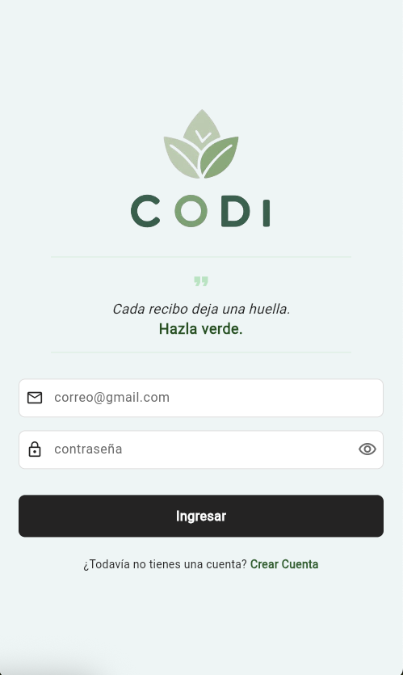
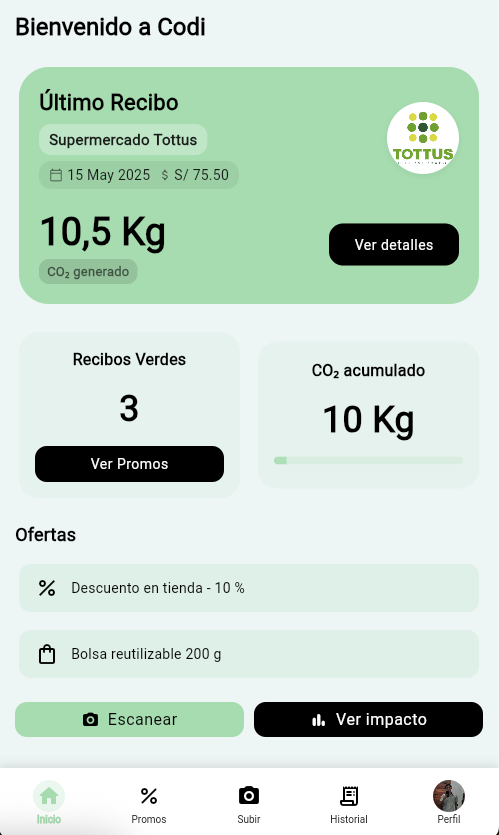
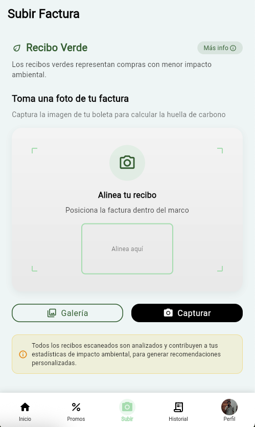
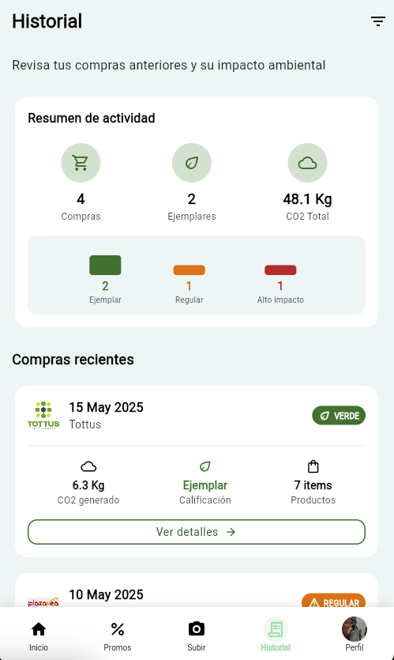
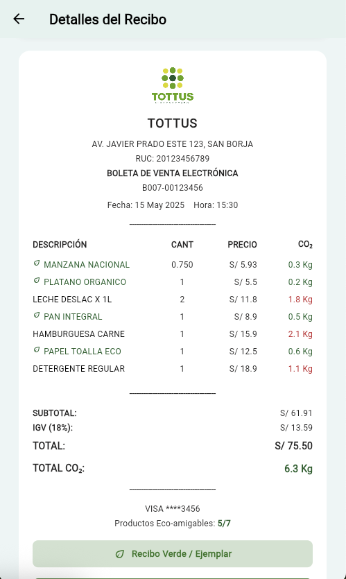

# 🌱 Codi - Recibos Eco-Amigables

## 📝 Descripción

**Codi** es una aplicación móvil desarrollada en **Flutter** que ayuda a los usuarios a tomar decisiones de compra más sostenibles mediante el análisis de sus recibos. La aplicación evalúa el impacto ambiental de las compras, calcula la huella de carbono asociada y premia a los usuarios por opciones eco-amigables.

---

## ✨ Características principales

- 📸 **Escaneo de recibos:** Captura fácilmente tus recibos mediante la cámara  
- 🌍 **Análisis de impacto:** Evaluación del impacto ambiental de tus compras  
- ✅ **Recibos verdes:** Sistema de clasificación que identifica compras sostenibles  
- 🎁 **Promociones ecológicas:** Recompensas y descuentos por elecciones responsables  
- 🧾 **Historial de compras:** Seguimiento de todas tus transacciones y su impacto  
- 🙋 **Perfil personalizable:** Configura tus preferencias de alimentación y estilo de vida  

---

## 🛠️ Tecnologías y librerías

- **Flutter** – Framework para desarrollo multiplataforma  
- **Dart** – Lenguaje de programación

### 📦 Librerías principales

- [`go_router`](https://pub.dev/packages/go_router) – Navegación y manejo de rutas  
- [`image_picker`](https://pub.dev/packages/image_picker) – Captura de imágenes desde cámara y galería  
- [`flutter_secure_storage`](https://pub.dev/packages/flutter_secure_storage) – Almacenamiento seguro de datos  
- [`path_provider`](https://pub.dev/packages/path_provider) – Acceso al sistema de archivos  
- [`flutter_animate`](https://pub.dev/packages/flutter_animate) – Animaciones fluidas  
- [`convex_bottom_bar`](https://pub.dev/packages/convex_bottom_bar) – Barra de navegación personalizada  

---

## 🔧 Configuración e instalación

### ✅ Requisitos previos

- Flutter SDK (`^3.7.0`)  
- Dart SDK  
- Android Studio / Xcode para desarrollo nativo  
- Conexión a internet para descarga de dependencias  

### 🚀 Pasos para instalación

1. **Clona el repositorio**

   ```bash
   git clone https://github.com/tu-usuario/codi.git
   ```

2. **Instala las dependencias**

   ```bash
   flutter pub get
   ```

3. **Ejecuta la aplicación**

   ```bash
   flutter pub get
   ```

### 📱 Capturas de pantalla

A continuación, se muestran algunas vistas de la aplicación:

<p align="center">








</p>

###  🚧 Estado del proyecto

Este proyecto se encuentra en desarrollo activo como parte de un hackathon. Futuras actualizaciones incluirán:

🔗 Integración con APIs de sostenibilidad

🛒 Mejoras en la detección automática de productos

🕹️ Gamificación para incentivar hábitos sostenibles

🤝 Comunidad para compartir consejos de consumo responsable
